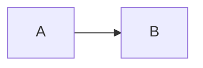
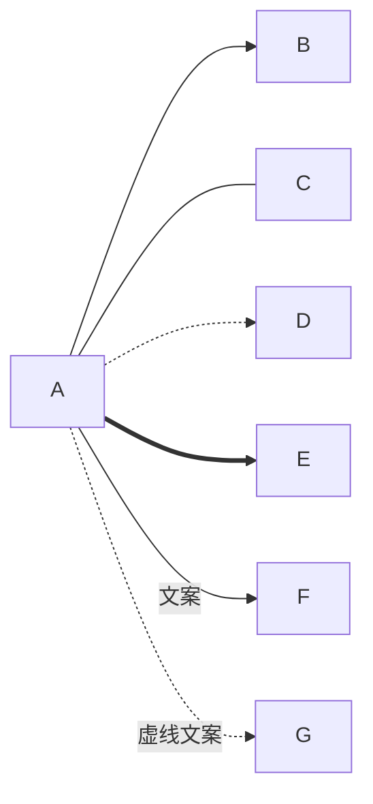
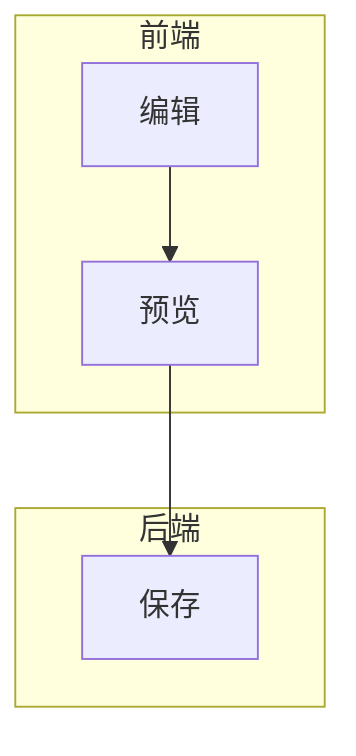
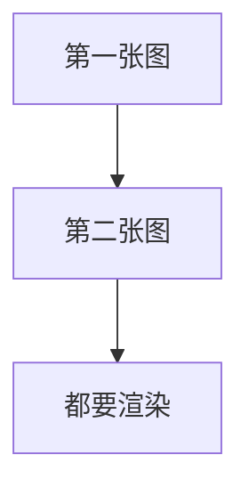
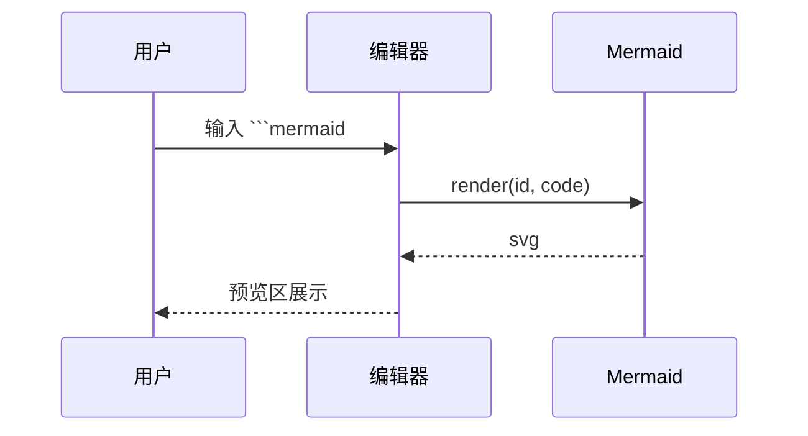
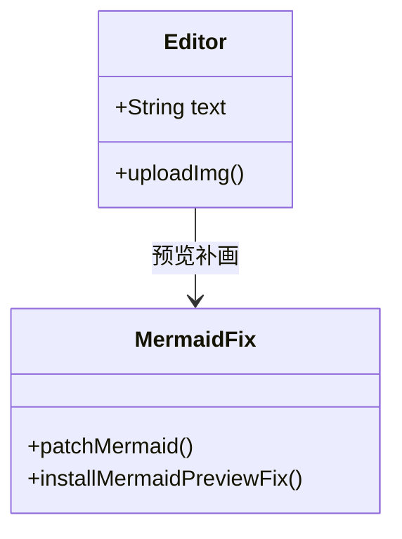
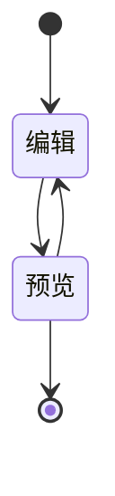
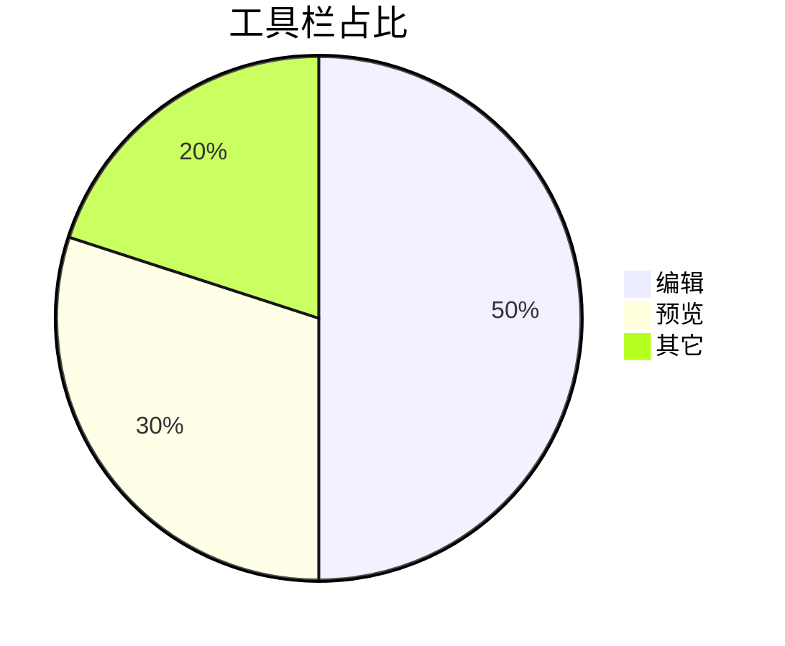
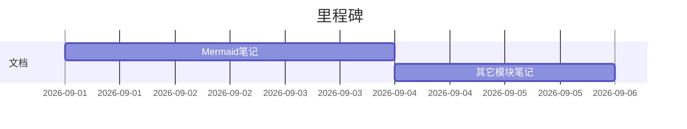

# Mermaid 必会用法 + 本项目相关语法

> 面向本仓库 `md-editor-demo`：既覆盖日常必会语法，也说明本项目里 Mermaid 是怎么接进预览的。

---

## 1. Mermaid 是什么

Mermaid 用**纯文本**描述流程图、时序图、类图等，再渲染成 SVG。

在 Markdown 里通常写成 fenced code block：

````markdown

````

本项目依赖：`mermaid@^11.9.0`（见 `package.json`）。

---

## 2. 五分钟上手（库侧）

### 2.1 安装与初始化

```bash
npm i mermaid
```

```js
import mermaid from "mermaid";

mermaid.initialize({
  startOnLoad: false, // SPA / 编辑器场景建议关掉自动扫描
});
```

本项目在 `src/mermaidFix.js` 里同样调用了：

```js
mermaid.initialize?.({ startOnLoad: false });
```

### 2.2 核心 API：`mermaid.render`

```js
const { svg } = await mermaid.render("unique-id", "flowchart LR\n  A --> B");
container.innerHTML = svg;
```

要点：

| 点 | 说明 |
| --- | --- |
| `id` | 每次渲染要唯一，否则会冲突 |
| 第二参 | 图源码字符串 |
| 返回值 | `{ svg, bindFunctions? }` |
| 并发 | Mermaid 11 **共用渲染容器**，并发 `render` 容易只成功最后一张 |

本项目正是因为第 4 点，才做了「串行队列 + 缓存 + MutationObserver 补画」。

### 2.3 最小独立示例（浏览器）

```html
<div id="out"></div>
<script type="module">
  import mermaid from "https://cdn.jsdelivr.net/npm/mermaid@11/dist/mermaid.esm.min.mjs";
  mermaid.initialize({ startOnLoad: false });
  const { svg } = await mermaid.render("g1", "flowchart TD\n  A-->B");
  document.getElementById("out").innerHTML = svg;
</script>
```

---

## 3. 必会图类型与语法（日常够用）

### 3.1 流程图 `flowchart`（本项目演示用的就是它）

方向：

| 关键字 | 含义 |
| --- | --- |
| `TB` / `TD` | 上 → 下 |
| `BT` | 下 → 上 |
| `LR` | 左 → 右 |
| `RL` | 右 → 左 |

节点形状（常用）：


连线：



子图：



**本项目默认示例**（见 `App.vue`）：




两张图同时存在，用来验证「多图都能画出来」（旧行为：并发时往往只剩最后一张）。

### 3.2 时序图 `sequenceDiagram`



常用箭头：`->` 实线、`-->` 虚线、`->>` 实线箭头、`-->>` 虚线箭头；`activate` / `deactivate` 表示激活框；`Note left of A: 备注`。

### 3.3 类图 `classDiagram`



### 3.4 状态图 `stateDiagram-v2`



### 3.5 饼图 / 甘特（了解即可）





### 3.6 易踩坑

1. **首行必须声明图类型**（`flowchart` / `sequenceDiagram` / …）。
2. 节点 id 建议用英文；显示文字放在 `[]` `()` `{}` 里。
3. Markdown 里用 **三个反引号 + `mermaid`**，不要多写语言别名导致不识别。
4. 语法错时本项目会显示：`图表语法错误：...`（`data-md-fix="err"`）。
5. **同一页多张图**时，不要假设可以随便并发 `render`（Mermaid 11）。

---

## 4. 本项目里 Mermaid 怎么接

### 4.1 角色分工

| 文件 | 作用 |
| --- | --- |
| `src/mermaidFix.js` | 队列化 `render`、SVG 缓存、Observer 补画 |
| `src/mdEditorConfig.js` | 关掉编辑器自带 Mermaid；markdown-it 渲染后套缓存 |
| `src/main.js` | 启动时再装一次 fix |
| `src/App.vue` | 工具栏 `"mermaid"` + 演示双图 + 错误样式 |

**刻意不讲 `md-editor-v3` 内部实现**，只记本仓库周边逻辑。

### 4.2 为什么要「关掉编辑器自带 + 自己补画」

原因（源码注释原意）：

- `md-editor-v3` 会对每张图调用 `mermaid.render`
- Mermaid 11 共用一个渲染容器
- **并发时只有最后一张成功**，前面的块停在源码

做法：

1. **`patchMermaid`**：把 `render` 串成 Promise 队列  
2. **`editorMermaidStub`**：编辑器扩展里塞假实例，`render` 直接 `reject("skip")`，避免和补画抢容器  
3. **`installMermaidPreviewFix`**：`MutationObserver` 盯住 `div.md-editor-mermaid`，用自己的 `mermaid.render` 画成 SVG  
4. **`svgCache` + `applyCachedMermaid`**：相同源码复用 SVG，刷新时别再变回源码

### 4.3 队列补丁（必懂）

```js
// 概念等价于 mermaidFix.js 里的 patchMermaid
instance.render = (...args) => {
  const job = queue.then(() => rawRender(...args));
  queue = job.then(() => undefined, () => undefined);
  return job;
};
```

无论成功失败，都推进队列，避免一条失败卡住后面的图。

### 4.4 缓存键

```js
const norm = (code) => String(code || "").replace(/\r\n/g, "\n").trim();
```

统一换行、去首尾空白，避免「看起来一样却缓存 miss」。

### 4.5 DOM 约定（和本项目强相关）

| 选择器 / 属性 | 含义 |
| --- | --- |
| `div.md-editor-mermaid` | 尚未画成 SVG 的源码块 |
| `data-closed="false"` | 代码围栏未闭合，跳过 |
| `data-md-fix="pending"` | 正在渲染 |
| `data-md-fix="err"` | 语法/渲染失败 |
| `data-processed` | 已替换为带 SVG 的块 |
| `p.md-editor-mermaid` | 画成功后的容器（本项目 `mountSvg` 会换成 `p`） |

错误样式在 `App.vue`：

```css
div.md-editor-mermaid[data-md-fix="err"] { /* 虚线边框警告色 */ }
```

### 4.6 空行占位与 Mermaid 闭合判断

`mdEditorConfig.js` 里 `preserveBlankLines` 会插入 `<div class="md-blank-line">`，**会改变行号**。

因此渲染时必须：

```js
const nextEnv = env ? { ...env, srcLines: String(next).split("\n") } : env;
```

否则前面的 mermaid 可能被当成「未闭合」，**只剩最后一张能画**——这是本项目第二处「多图」相关坑。

### 4.7 工具栏

`App.vue` 的 `toolBars` 含 `"mermaid"`：点工具栏插入 mermaid 代码块，右侧预览走上述 fix 管线。

---

## 5. 推荐练习路径

1. 在编辑区改 `flowchart` 方向（`LR` ↔ `TD`），看预览是否两张都更新。  
2. 故意写错一行（如缺 `]`），确认出现「图表语法错误」。  
3. 复制第三张相同源码的图，确认缓存命中（应瞬间出现，不闪源码）。  
4. 离开本项目，用纯 `mermaid.render` 写一个多图页面，先并发、再串行，对比结果。

---

## 6. 速查表

```text
声明图类型 → 写节点/边 → 包进 ```mermaid → 预览

库：initialize({ startOnLoad: false }) + await mermaid.render(id, code)

本项目：stub 关自带 → patch 串行 → Observer 补画 → cache 回写 HTML
```

官方文档：[https://mermaid.js.org/](https://mermaid.js.org/)
